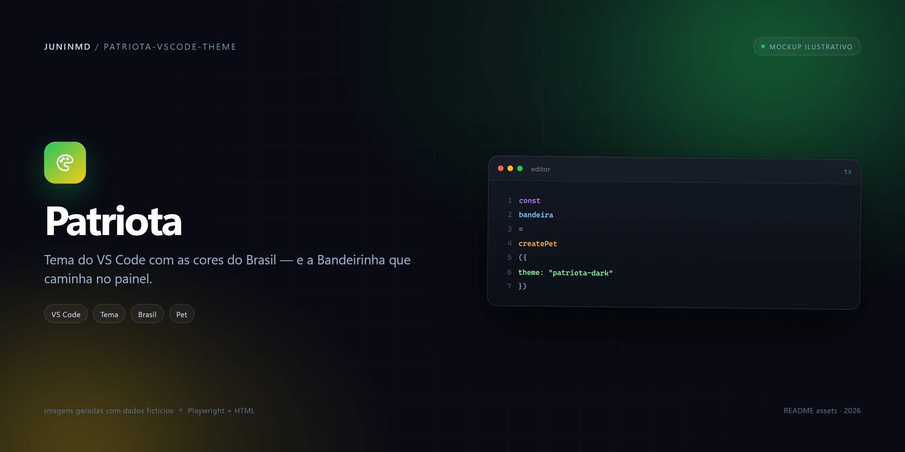
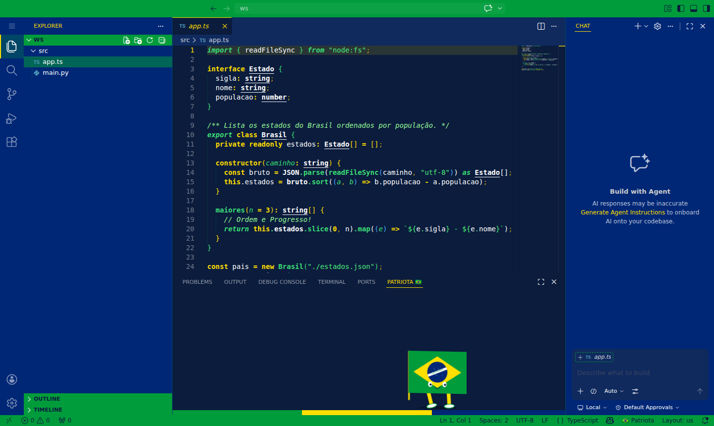
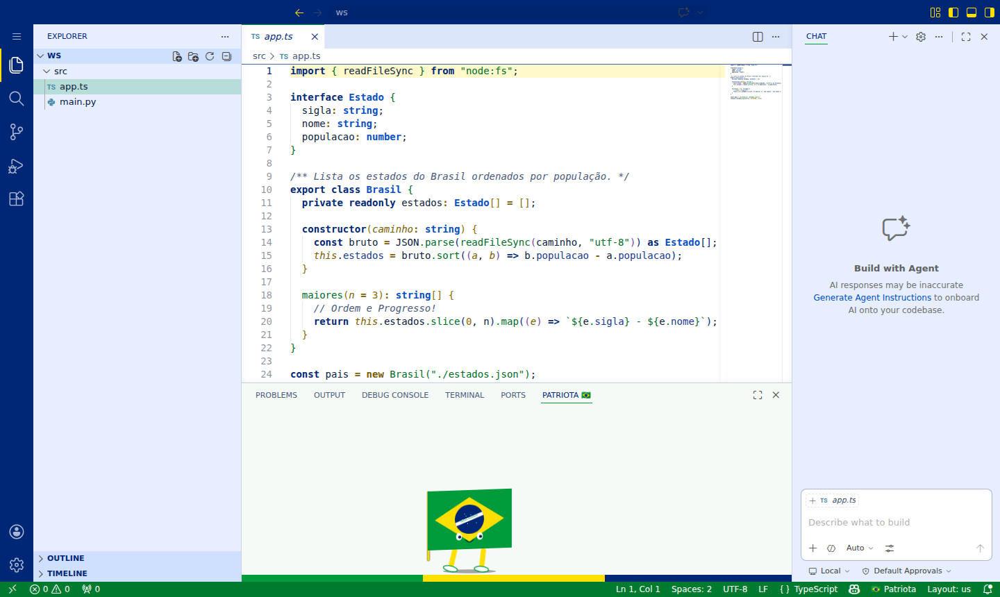
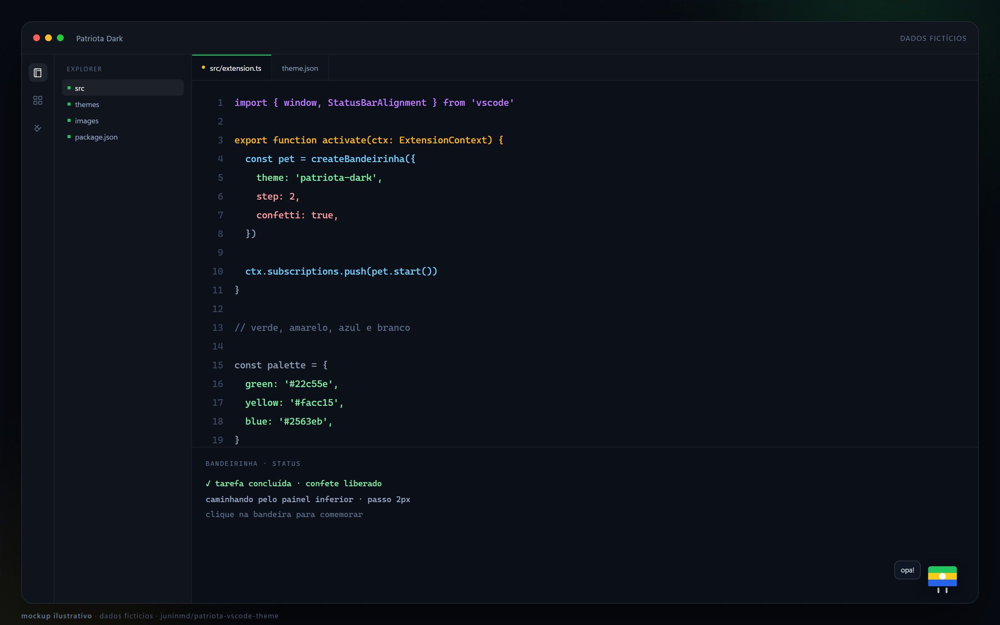

# Patriota 🇧🇷 — tema e pet para VS Code

<p align="center">
  
</p>

Tema para VS Code com as cores da bandeira do Brasil, em duas variantes (escura e clara), e **Bandeirinha**: uma bandeira com perninhas que caminha pelo painel inferior, comemora quando uma tarefa termina e solta confete quando você clica nela.



## Instalação

Pré-requisitos: VS Code **1.72** ou superior (`engines.vscode`) e Node.js **22** (`.nvmrc`) para gerar o pacote.

```bash
git clone https://github.com/juninmd/patriota-vscode-theme.git
cd patriota-vscode-theme
npm ci
npm run package
code --install-extension patriota-1.7.5.vsix
```

O VSIX é o caminho de instalação documentado aqui. O script `scripts/publish.sh` publica o pacote quando `VSCE_PAT` e/ou `OVSX_PAT` estiverem definidos (veja [PUBLISHING.md](PUBLISHING.md)). Para desenvolver o tema, abra a pasta no VS Code e pressione **F5**.

Depois de instalar, escolha o tema com **Ctrl+K Ctrl+T** (ou **Preferences: Color Theme**) e selecione:

| Variante | Label no VS Code | `uiTheme` |
|---|---|---|
| Escuro | `Patriota` | `vs-dark` |
| Claro | `Patriota Claro` | `vs` |

## As duas variantes

| Patriota (escuro) | Patriota Claro |
|---|---|
|  |  |

## Paleta

O azul (`#002776`), o verde (`#009c3b`), o amarelo (`#ffdf00`) e o branco estruturam a paleta; tons de apoio completam o contraste no editor.

| Papel | Patriota (escuro) | Patriota Claro |
|---|---|---|
| Fundo do editor | `#0b1c3d` | `#ffffff` |
| Texto do editor | `#ffffff` | `#0b1c3d` |
| Activity bar | `#002776` | `#002776` |
| Sidebar (escuro) | `#002776` | — |
| Sidebar (claro) | — | `#e6eeff` |
| Title bar | `#009c3b` | `#002776` |
| Status bar | `#009c3b` | `#007a2e` |
| Cursor | `#ffdf00` | `#002776` |
| Seleção | `#ffdf0055` | `#ffdf0088` |
| Keywords, números e constantes | `#ffdf00` | `#002776` |
| Funções, parâmetros e tags | `#3bdc75` | `#006b28` |
| Strings | `#4cea7a` | `#006b28` |
| Comentários | `#98fb98` | `#4a5a7d` |
| Tipos e classes | `#ffffff` | `#0a4fc4` |
| Texto inválido | `#ff5555` | `#d32f2f` |

O gallery banner usa `#002776` com tema escuro, conforme o `package.json`.

Cores de apoio no escuro:

| Uso | Hex |
|---|---|
| Terminal: verde / amarelo / azul / vermelho | `#3bdc75` / `#ffdf00` / `#4da6ff` / `#ff5555` |
| Git: arquivo modificado / adicionado | `#ffdf00` / `#3bdc75` |
| Erro / aviso / info | `#ff5555` / `#ffdf00` / `#ffffff` |
| Ghost text (sugestão inline) | `#ffffff77` |

## Compatibilidade

O tema requer VS Code **1.72+**. O realce semântico só aparece quando o language server da linguagem fornece os tokens e o `editor.semanticHighlighting.enabled` está ligado; os brackets coloridos dependem da colorização de pares do editor. Nada disso é exclusivo do Patriota — o tema define as cores, o editor decide quando aplicá-las.

## O que o tema cobre

- **Workbench completo**: editor, activity bar, sidebar, abas, status bar, title bar, terminal, debug, testes e SCM graph.
- **Brackets coloridos**: seis níveis (`editorBracketHighlight.foreground1` a `foreground6`) e guias de pares ativos.
- **Chat e Copilot**: 17 chaves de chat e inline chat, mais `editorGhostText` para sugestões inline.
- **Realce semântico**: 22 entradas em `semanticTokenColors` para classes, funções, métodos, namespaces, parâmetros e variáveis.
- **Ícones de símbolos**: cores para os símbolos da outline e do breadcrumb.

O tema claro é gerado a partir do escuro por `scripts/build_light.py`; os dois arquivos finais ficam em `themes/patriota-color-theme.json` e `themes/patriota-light-color-theme.json`.

## Bandeirinha, o pet


O pet vive no painel inferior, dentro do container **Patriota 🇧🇷**, na view **Bandeirinha**. Ele anda de um lado para o outro, para de vez em quando e mostra frases como “Ordem e Progresso!” e “Bora codar!” em um balão.

| Ação | Como |
|---|---|
| Chamar o pet | Comando **Patriota: Chamar o pet Bandeirinha** ou clique no item `🇧🇷 Patriota` da status bar |
| Fazer o pet comemorar | Clique nele, ou rode **Patriota: Comemorar! 🎉** |
| Comemoração automática | Toda tarefa do VS Code que termina com código de saída `0` dispara a comemoração |
| Tamanho | `patriota.pet.size`: `small` (80 px), `medium` (120 px), `large` (170 px) |
| Velocidade | `patriota.pet.speed`: `slow` (0,5), `normal` (1), `fast` (1,8) |

A comemoração é um pulo com 40 confetes nas quatro cores da bandeira e a frase “GOOOOL!”. As configurações são lidas pela view e atualizadas ao vivo quando você muda o `settings.json`.

Um `settings.json` típico:

```json
{
  "workbench.colorTheme": "Patriota",
  "patriota.pet.size": "medium",
  "patriota.pet.speed": "normal"
}
```

### Como desativar

Não existe uma configuração `enabled` para o pet. Para escondê-lo:

- clique com o botão direito no título da view **Bandeirinha** e escolha **Hide** (o painel pode ser reaberto pelo comando ou pela status bar); ou
- desabilite a extensão `juninmd.patriota` no workspace/globalmente em **Extensions**.

A status bar `🇧🇷 Patriota` faz parte da extensão e desaparece junto quando ela é desabilitada.

## Desenvolvimento

Pré-requisitos adicionais: Python 3.8+ (`pyproject.toml`) e `pytest` para os testes de validação.

```bash
npm ci
npm run validate                    # python3 scripts/validate_theme.py (cores e contraste)
npm test                            # python -m pytest tests
python3 scripts/build_light.py      # regenera o tema claro
python generate_preview.py          # preview do tema
npx @vscode/vsce package            # gera o .vsix
```

O script de screenshots abre um VS Code real via `code-server` e Playwright:

```bash
npm run screenshots                 # requer code-server no PATH (ou CODE_SERVER_BIN)
```

Estrutura relevante:

```text
themes/                 # os dois temas finais (JSON)
src/extension.js        # status bar, view do pet, comandos e cheer em tarefas
media/                  # pet.js, pet.css, flag.js e ícones
scripts/                # validação, geração do tema claro, screenshots, publicação
tests/                  # manifest, contraste e validação do tema
images/                 # capturas usadas neste README
```

O `src/extension.js` registra a view Webview, injeta uma CSP com nonce, escuta mudanças de configuração e usa `vscode.tasks.onDidEndTaskProcess` para comemorar. O desenho da bandeira fica em `media/flag.js`; a animação e as frases, em `media/pet.js`.

### CI

| Workflow | O que roda |
|---|---|
| `validate.yml` | Instala Python e `pytest`, depois o gate de validação de PR |
| `release.yml` | `npm run validate`, `npm test` e `semantic-release` em push para `master` |
| `sast.yml` | Análise estática via workflow reutilizável (relatório, não bloqueia) |
| `security.yml` | Varredura de segredos (Gitleaks) em push |
| `dependabot-auto-merge.yml` | Auto-merge de PRs do Dependabot quando os checks passam |

O versionamento é automático por Conventional Commits; a publicação nas lojas depende dos secrets `VSCE_PAT` e `OVSX_PAT`.

## Imagens

> [!NOTE]
> **Mockups ilustrativos.** As telas abaixo foram geradas em HTML com dados fictícios (Playwright) e não são capturas de uma instalação real.

<p align="center">
  
  <br>
  <sub>Patriota Dark — dados fictícios.</sub>
</p>


## Limitações

- **O pet não substitui o mascote do Copilot.** O Copilot não expõe API para trocar o mascote, e uma extensão não altera outra; a Bandeirinha é um pet próprio, na view da extensão.
- **Só no painel inferior.** O pet não flutua sobre o editor nem aparece em outras áreas do workbench.
- **Sem atalho de teclado.** Os dois comandos do pet não têm `keybindings` padrão.
- **A publicação não está no repositório.** O VSIX é gerado localmente; os scripts de loja exigem tokens que não acompanham o código.
- **Tema claro é derivado.** Alterações no escuro precisam ser refletidas no gerador (`build_light.py`) para não divergirem.

## Links

- [Issues](https://github.com/juninmd/patriota-vscode-theme/issues)
- [Discussions](https://github.com/juninmd/patriota-vscode-theme/discussions)
- [CHANGELOG.md](CHANGELOG.md) · [ROADMAP.md](ROADMAP.md) · [CONTRIBUTING.md](CONTRIBUTING.md)

## Licença

[MIT](LICENSE).
